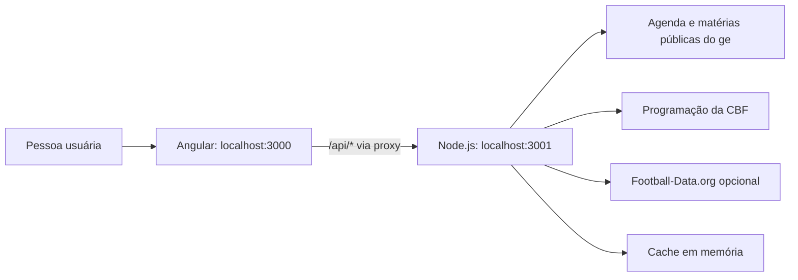

# Arquitetura

## Visão geral

O projeto tem duas partes executadas localmente: uma interface Angular e uma API Node.js. A interface chama a API pelo caminho `/api`; durante o desenvolvimento, o proxy do Angular encaminha essas chamadas para a porta 3001.

## Frontend

O frontend fica em `client/` e usa Angular standalone components, TypeScript, templates HTML e PrimeNG. As rotas principais são:

| Rota | Componente | Função |
| --- | --- | --- |
| `/` | `SchedulePage` | Agenda por data e competição |
| `/jogos/:id?data=AAAA-MM-DD` | `MatchDetailPage` | Detalhes, transmissão e pré-jogo |
| `/blog` | `BlogPage` | Lista de artigos de exemplo |
| `/blog/:slug` | `BlogPage` | Exibe um artigo de exemplo |

`MatchesApiService` concentra as chamadas HTTP. Os tipos compartilhados entre o frontend e a API estão em `client/src/app/models/match.ts`. Datas e horários usam o fuso `America/Sao_Paulo`.

## API Node.js

`server.mjs` usa o servidor HTTP nativo do Node.js. Não há framework web nem banco de dados. Ele carrega `.env` manualmente, valida datas e IDs, consulta as fontes e devolve JSON.

No desenvolvimento, o servidor usa `127.0.0.1:3001`; o Angular usa `client/proxy.conf.json` para encaminhar `/api` à API. A API não entrega o frontend e não deve ser publicada como servidor aberto sem uma configuração de produção adequada.

## Fluxo da agenda

1. A tela solicita `GET /api/matches?date=AAAA-MM-DD`.
2. A API consulta em paralelo o ge, a CBF e, se configurada, a Football-Data.org.
3. Se a agenda do ge retorna partidas, ela fornece os confrontos e horários principais.
4. A CBF pode completar informações de transmissão e servir como fonte alternativa de partidas.
5. Quando disponível, a Football-Data.org complementa placar, status e eventos de gol. A associação exige correspondência única de data, horário e nomes normalizados dos clubes.
6. A API devolve a origem usada, os dados disponíveis e indicadores de informação antiga ou de cobertura indisponível.

Os detalhes da prioridade entre fontes e os limites de cada uma estão em [fontes-e-dados.md](fontes-e-dados.md).

## Fluxo da prévia da partida

Ao abrir um jogo, o frontend solicita `GET /api/matches/:id/preview?date=AAAA-MM-DD`. A API localiza a partida na agenda do ge, tenta construir e buscar uma matéria específica e depois procura uma matéria geral da rodada quando aplicável. A resposta contém o título, resumo, link original, times, provável escalação e desfalques encontrados no texto.

Os dados são extraídos de páginas públicas do ge. Se a página não existir ou não trouxer escalação/desfalques, a resposta informa essa ausência; o servidor não inventa nomes.

## Cache e persistência

Os caches ficam em `Map` na memória do processo. A resposta de partidas é armazenada por dois minutos; a agenda do ge e a programação da CBF por até seis horas; matérias do ge por uma hora; prévias bem-sucedidas por 30 minutos; e tentativas sem prévia por dez minutos. Falhas de atualização da agenda podem ser retentadas após 15 minutos. Reiniciar o processo limpa os caches. Não há banco de dados ou armazenamento permanente.

## Tratamento de falhas

- As fontes externas são consultadas com timeout.
- A atualização da agenda, da CBF e da Football-Data.org é tolerada em paralelo; uma fonte indisponível não bloqueia automaticamente as demais.
- Quando há dados anteriores em cache, a API pode devolvê-los marcados como antigos (`stale: true`).
- Os erros da API usam JSON no formato `{ "error": "mensagem" }`.
- A interface distingue canal confirmado, canal que precisa de revisão e canal não confirmado.

